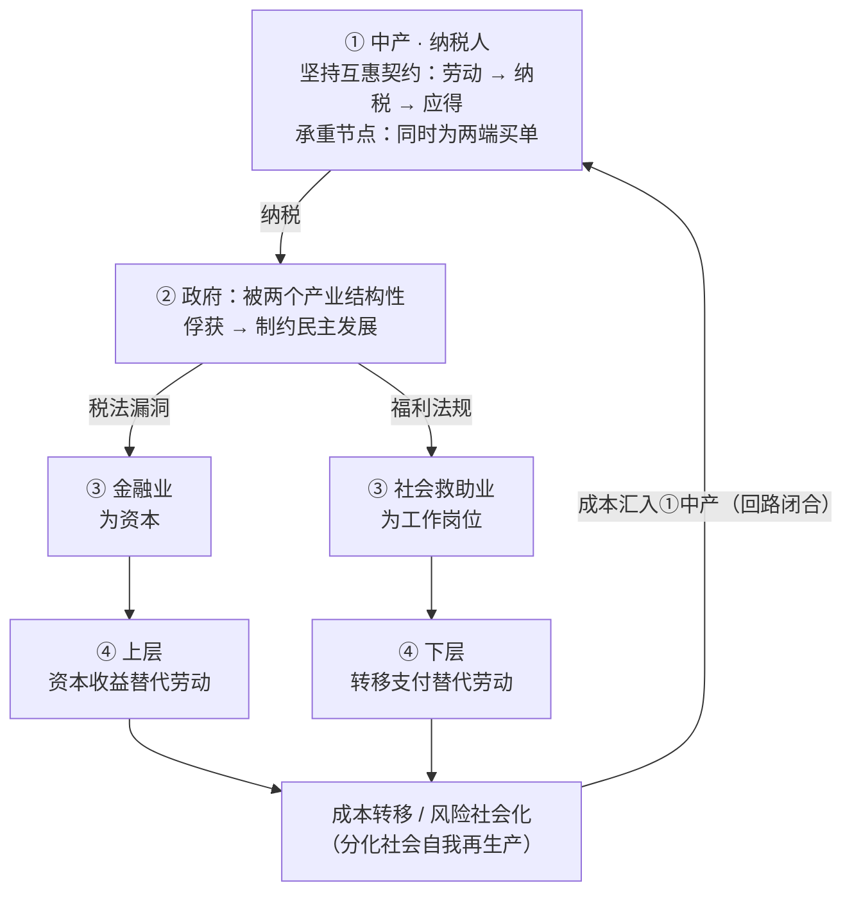

# 《反社会的人》结构性读书报告

**Walter Wüllenweber, *Die Asozialen: Wie Ober- und Unterschicht unser Land ruinieren – und wer davon profitiert*, 2012**

**报告性质**：个人知识库条目。正文为分析性叙述；“原文锚点”为你在阅读中画线的句子，置于各节末尾，用于日后召回作者原话，不进入正文论证。

*本文是和 deep seek 对话之后产生，由 deep seek 代写，我 review* 

## 一、核心概念界定：“反社会”与“下层社会”不是道德骂名

报告的第一件事，是把作者的关键词从日常语义中剥离出来。

书中的“反社会”（Asozial），指向的是**从公民互惠关系中系统性退出**。作者的操作性定义是“不提供可被利用的绩效”，以及上层与下层“几乎不再感受到绩效与成功之间的关联”，“钻空子”逐渐成为一种生活方式。两端不再共享多数社会的价值与道德想象。

“下层社会”的定义同样不是收入贫困。作者明确指出，问题“不是贫穷，而是教育匮乏、缺乏学习意愿，以及由此导致的参与受阻”；判断阶层归属的是一套**生活方式层面的指标**——居住文化、饮食、自我纪律、工作意愿——而非银行账户余额。用你自己的话说，这是一种**“精神世界的匮乏”**：不是没有钱，而是与市民社会的绩效伦理和互惠规范脱钩。

同样重要的是作者写作意图的定位：**他揭示一种结构，而不提供终极方案**。全书以“最终没有解决方案”收束，这意味着把它读成一份“诊断书”比读成“处方”更符合原意。诊断的对象不是两端的具体个人——人是趋利避害的——而是**使“退出互惠”成为理性选择的制度安排**。

**原文锚点**

> 较之金钱的匮乏，受教育机会的缺失才是下层阶级的主要标志。下层阶级和中产阶级之间的区别并非收入水平，文化上的差异才是横跨在两者之间的鸿沟。

> 我认为下层阶级的生存现状不能归结为经济的匮乏。事实上，经济上的匮乏非但不是导致下层阶级行为模式的原因，反而是其特有文化引发的结果。真正的贫穷并不体现在钱包里，而是在精神上，再多的金钱也不能弥补这方面的匮乏。

> 我们必须扪心自问，是否我们只是将穷人视为救济的对象，而不是将他们看作独立的个体，并鼓励他们成为社区中活跃的一份子。

## 二、全书的逻辑链

全书可以读成一个闭合回路，而不是一条从“富人”到“穷人”的线性道德故事：

**① 中产 · 纳税人**是唯一仍在坚持“劳动 → 纳税 → 应得”这一互惠契约的群体，也是整个结构的承重节点。**② 政府**在制度设计上被两个产业以不同方式俘获：金融业“为资本”服务，救助业“为工作岗位”服务；政府通过税法漏洞和福利法规，分别使两个产业的扩张获得制度空间。**③ 金融业**与**③ 社会救助业**共享三个特征——不透明经营、增长既是经济目标也是生存需求、免税或低税——区别只在于“for what”：金融业为了资本，救助业为了工作岗位。两个产业分别使**④ 上层**（资本收益替代劳动）和**④ 下层**（转移支付替代劳动）得以脱离互惠链条。两端的成本再通过**风险社会化**转移回中产，回路闭合。救助业一侧还附着一个**眼镜蛇效应**的旁注：问题在被“解决”的过程中被再生产。

这条链最容易被误读的地方是“对称”。作者的修辞确实是对称的，但**证据类型并不对称**：下层的“反社会”被呈现为可观察的生活方式，上层的“反社会”则被呈现为结构性的资本退出。这一不对称本身，是第四节要处理的问题。

**原文锚点**

> 有别于中产阶级，生产绩效对这两个生活在平行社会的阶级来说丝毫不具备同等的意义。善于寻找和利用法律漏洞正日渐成为这两个社会阶层所共有的特性。而德国政府却在经济上资助了这种社会离心运动的发展。中产阶级基本上是在独立维持社会的正常运作，其缴纳的高额税收既化解了财富阶层金融投机行为所带来的风险，同时又保障了下层阶级坐享各种社会福利。

> 金融行业控制着大部分金钱，而救助产业则提供了大量的工作岗位。两者在德国就意味着资本和工作，而与工作岗位和资本捆绑在一起的就是权力。……社会的分化是它们共同的目标。它们是上层和下层阶级这两个平行社会的推动者。

> 对于这两个领域的企业来说，高速增长并非只是其经济目标，同时也是其生存的需要。

> 这两者都不能算作实体经济的一部分。它们是一种植根于平行社会的平行经济，当实体经济企业还在为每一点增长咬紧牙关时，这两个平行经济产业却在经历着前所未有的高速发展。

> 民主政治的一个核心精神就是允许对已经做出的决定进行修正。但这一点在金融和社会救助产业却是行不通的。它们仅仅凭借着自己的规模就已经制约了民主的进程。

## 三、隐性假设：不是“财富应来自劳动”那么简单

你最初的表述“财富应该通过劳动获得”方向是对的，但需要精确化。作者预设的是一种**劳动公民观**：劳动不只是收入来源，更是社会成员资格、纪律结构和互惠义务的载体。书中反复出现的“绩效意愿”（Leistungsbereitschaft）一词，正是这一预设的关键词。作者把“按劳分配”明确称为“社会道德基础的一部分”，并指出它“不仅保障了社会的富足，同时对社会的内部团结起着举足轻重的作用”。

这一预设的争议性在于：它把“劳动—绩效—应得”当作公民身份的自然锚点，却没有正面回应两个反驳。自由至上主义者可以问：资本收益凭什么不比劳动收入更“正当”？基本收入的支持者可以问：公民资格为什么必须以劳动为条件？作者没有处理这些反驳，而是**把劳动公民观作为默认背景**来展开批判。这使得全书的道德力量很强，但**理论上的可辩驳性较弱**：它说服的往往是已经共享这一前提的读者。批评者还指出，作者“预设了静态的人类需求，仿佛人需要多少物质和金钱是清楚的”——这是一个方法论上的附带假设：它把“体面生活”的基准固定下来，从而使“退出”可以被识别，但也回避了需求本身的历史可变性。

**原文锚点**

> 他们依靠中产阶级所创造的价值生存，其典型的收入并非工作所得，而是社会救济金及资本投资收益。这并非单纯的国民经济问题，因为按劳分配的观念在过去的几十年中一直是社会道德基础的一部分。它不仅保障了社会的富足，同时对社会的内部团结起着举足轻重的作用。作为德国文化的核心部分，目前还没有其他价值观能够取代其地位。但对于上层阶级和下层阶级来说，这一价值观却已失去了存在的意义，而政府对这一现象的纵容将对整个社会造成极大的威胁。

> 曾经自豪的工人阶级不单是在第一线从事生产的群体，还代表了一种价值观。勤劳、可靠和坚强这些品质在他们身上都得到了体现。如今的德国中产阶级却更加符合曾经的工人阶级形象，他们才是在国民经济中创造价值的生产模范。

## 四、论证的不对称性与方法论局限

**金融部分的“薄”不是偶然的。** 救助业部分之所以有力，是因为记者调查可以进入机构、采访从业者和领取者、追踪一个领取者的消费清单或一个福利集团的财务结构。金融业的运作则发生在交易结构、税法条款和跨境监管套利之中；**采访银行家或统计利润，无法充分揭示资本的政治权力**。这是方法论与对象之间的错配，而非单纯的写作懈怠。评论者对此的概括是：作者的社会科学工具“并不处于最佳状态”，对上下之间的描绘“黑白分明”。作者自己也承认：“有别于自然科学，经济学是一门建立在假设和理论上的学问，其中没有绝对的对错。”但他没有把这一认识论自觉转化为对金融章节写作方法的反思。

**“对称”是需要检验的分析命题，不是可以直接接受的前提。** 两端共享“绩效与成功脱钩”这一特征，但上层脱钩的制度载体（税法、资本流动、监管套利）与下层脱钩的制度载体（转移支付、资格认证、育儿供给）在**可改革性**上完全不同。把两者放在同一个“反社会”标签下，修辞上很有力，分析上却可能掩盖了不同的政治经济学。

**原文锚点**

> 金融行业已经与现实经济失却了联系。……金融行业将理性的原则抛之脑后，听任市场转变成非理性经济的殿堂。面对金钱宗教的神通，科学也显得无可奈何。失去控制的金融市场揭示了经济学的无能。有别于自然科学，经济学是一门建立在假设和理论上的学问，其中没有绝对的对错。然而量子人通过数学模型所创造的奇迹在银行经理人的头脑中制造了一种安全感的假象，让人觉得量子人知道自己在做什么，因为他们的结论都是计算出来的。

> 令所有投机泡沫开始膨胀的前提就是太多的金钱被集中在少数人手里。而这些有钱人也不知道该如何利用手中的巨额财富。特别是当他们不需要为此付出相应的劳动时，就失去普通的价值观念。其结果就是：上层阶级开始赌博。

## 五、十三年后的验证：AI、难民、经济下行

### AI：中产被“重新定价”，而非被“淘汰”

DIW Berlin 2025–2026 年的研究给出了一个精确的机制：**AI 主要冲击的不是低收入者，而是中间收入层**；更高的 AI 采用率在**高收入五分位带来工资增益，在中间层则可能带来轻微工资损失**。具备 AI 技能的员工获得显著工资溢价，而卡在中间的人面临工资侵蚀。

这修正了你之前“中产被淘汰成为下层”的直觉。更准确的机制是：**中产劳动相对于资本的议价能力被系统性削弱**。不是大规模失业，而是生产率增益的果实系统性地流向资本和高技能互补者，中间层的劳动收入份额被压薄。2026 年 2 月德国 IT 行业失业人数同比增加近 23%，也指向同一方向：不是中产整体消失，而是**中产内部的分化加速**——上半部分向资本收益靠拢，下半部分向下行压力靠拢。

这验证了全书最深的那条判断，却以一种作者没有充分预见的方式：**“劳动—成功”链条的断裂，原本发生在社会两端，现在开始向中产自身渗透**。作者在 2012 年写“对生产绩效的追求失去往日的意义”时，指的是两端；2026 年的问题是，这个判断是否正在向承重者自身延伸。

### 难民：救助业的“需求侧扩张”，而非“供给侧改革”

难民的到来确实在短期内放大了救助业的规模，但 IAB 2025 年的研究给出了一个需要精确对待的结论：**没有证据表明公民津贴本身阻碍了难民融入劳动力市场**，“工作的人并不比不工作的人处境更好”这一说法并不成立。真正的问题不是“福利让人躺平”，而是**融入过程的结构性漫长**：语言、资格认证、育儿共同拉长了从抵达至就业的时间。

但另一组数据指向了作者式的判断：基本收入支持接受者的**融入率在过去四年持续下降，且未恢复到疫情前水平**；难民来源国公民的就业率虽然在部分群体中改善，但绝对水平仍然远低于总体移民就业率。救助业不需要“制造”永久依赖；它只需要一个**融入成本高到使“不工作”在净收入上不显著劣于“工作”的结构**。难民没有“创造”救助业，但救助业找到了一个在法律和道义上都更难被质疑的客户群体。

### 经济下行：风险社会化的加速器

经济下行放大了全书的核心机制，而不是改变了它。当增长收缩时，**资本损失的公共化压力上升，福利支出的财政压力也上升**，两条成本流同时汇向中产纳税人。作者在 2012 年描述的“两端退出、中产承重”的结构，在下行周期中不是被削弱，而是被**加固**：因为两端都更有动力、也更有话语权去主张“救助”的必要性——一端是系统重要性，一端是人道主义。

**原文锚点**

> 在经济界已经存在一种扭曲的刺激，政府的过度保护诱使企业形成无限制的增长。这些企业知道政府除了对其进行没有底线的援助外别无他法。

> 社会福利制度意味着强者有帮助弱者的义务。但在金融界却上演着截然相反的一幕。纳税人必须帮助最富有的 1% 保障其巨额财富的安全，而上层阶级却不属于纳税人的行列。尽管他们的投机行为已经威胁到了国民经济的稳定，但财政部却只对其征收一点儿象征性的税金。

## 六、横向对比：北欧的制度信任与中国的央地风险社会化

### 北欧：关键不是“高福利”，而是“转移支付压缩市场差距 + 财政决策靠近纳税人”

你对芬兰“工程师和收银员税后差不多”的刻板印象需要一次机制修正。北欧再分配的核心不是高度累进的所得税，而是**高平均税负、相对低的累进性，加上激进的转移支付**；丹麦的公共转移支付占家庭净收入的比重显著高于德国。更关键的是财政结构：**丹麦的税收绝大部分由地方/区域层面支出，而德国联邦政府掌握最大份额的税收收入，市镇则长期资金不足**。北欧的高福利之所以没有产生德国式的“中产被两端挤压”的政治反弹，一个不可忽视的条件是**决策可见性与制度信任**：纳税人能够看到钱花在附近，而不是被遥远的联邦机器和产业游说结构吸走。北欧福利模式中“对人的信任”处于高位，这不是文化副产品，而是**制度设计长期再生产的结果**。

德国缺的不是福利水平，而是两个结构性环节：**低端劳动的税后回报相对于转移支付没有形成足够清晰的“工作值得”信号**；**救助与劳动市场之间缺乏北欧式的“激活导向”强硬连接**——不是制裁，而是可信的育儿供给、快速的资格认证、以及让第一份工作真正在净收入上拉开差距的转移支付设计。用作者的话说，德国用钱解决社会问题的“条件反射”之所以失效，不是因为钱不够，而是因为**钱没有改变“工作 vs 不工作”的净差额结构**。

**原文锚点**

> 政府一直以来都试图用钱来解决所有的社会问题，这就像是德国社会福利制度的条件反射。用于救济的拨款数额一再提高，而社会中那些无法用金钱填补的沟壑则越来越深。……德国在消除社会不平等性方面所用的策略就像被关在屋子里的苍蝇，寻找突破的过程中只会一次又一次，一次又一次地撞击玻璃。

> 有了工作收入就得自己付孩子的赡养费，剩下的钱和领失业救济金差不多。不是每个人都值得去工作，这在下层阶级的圈子里属于常识。

### 中国：结构类比与差异分析

**结构类比成立**：单一制下，地方政府一旦无力偿债，中央政府实际上承担无限救助责任，这形成了**预算软约束和道德风险**——地方政府预期到最终救助，便有动力大规模举债进行投资；隐性债务的扩张在相当程度上是这一激励结构的产物。恒大的违约则标志着一个更具体的模式走到尽头：“地方财政 + 开发商 + 金融杠杆 = GDP 和政绩”。这与伍伦韦伯描述的“决策者享有上行收益、下行风险由制度吸收”在形式上是同构的。

**差异同样关键**：在德国，救助业与金融业是**两个平行的产业**，经由政府这个节点汇合；在中国，地方政府同时是**福利兜底的行政主体**和**投资扩张的推动者**，“救助”与“赌博”经由同一个节点**合一**。道德风险的方向因此更集中：不是“上层赌博、下层躺平、中产买单”的三方结构，而是**地方增长联盟将投资风险向上转移给中央财政、向下转移给普通纳税人**的双向社会化。你读《置身事内》《大国大城》时关注的央地关系，在这里恰好提供了一个比“中国版《反社会的人》”更精确的分析入口：**不是两端脱离劳动，而是地方政府作为增长机器，同时生产了投资端的道德风险和福利端的兜底责任**。

**原文锚点**

> 令危机加剧的首要前提就是收入及财富的分配不均。……历史上的经济危机带给我们的教训是：上层阶级是所有投机泡沫的制造者。只有他们才拥有足够的金钱来进行非理性投机。财富分配的极度不均不但具有其不公正性，同时对任何社会经济都是一件危险的事。

> 上层阶级将维持国家运作的重任推到了中产阶级身上，但其与金融行业为国家造成的损失却必须用普通人缴纳的税收来弥补。可以说德国的弱者正在帮助最强者。

## 七、未竟问题清单

1. **替代性的制度想象是什么？** 作者只给出诊断，不给出处方。如果劳动公民观本身是一个有争议的规范性立场，不共享这一前提的读者能从书里拿走什么？
2. **金融业的“不透明”需要哪一类补充分析？** 记者调查能揭示救助业的微观机制，但金融权力的揭示需要政治经济学、监管政治学和资本流动政治学。这本书的“薄”恰好标出了这个缺口。
3. **“对称”在多大程度上是修辞建构？** 两端共享“绩效脱钩”，但制度载体和可改革性不同。把“反社会”同时用于两端，分析上是否过度统一了异质的现象？
4. **中产承重之后呢？** 全书把中产放在承重位置，但没有追问：当中产自身开始经历“劳动—成功”链条的松动（AI 重新定价），承重结构还能维持多久？这是 2013 年的书留给 2026 年的最大未竟问题。

## 八、结语：唯一值得记住的理由

这本书在事实层面有薄处，在理论上有一个未经辩护的劳动公民观前提，在金融分析上受限于记者方法。但它有一个不可替代的贡献：**它用“互惠义务从两端同时脱落、中产承重”这一框架，把分散的、看似对立的社会现象——资本收益的税收特权、福利产业的扩张、中产的税负感知——放进同一个因果回路里**。

对我个人而言，它值得被记住的唯一理由，不是“德国社会正在解体”这个耸动的判断，而是：**我就是那个承重位置上的德国中产——留德十年，工作四年，纳税，缴社保，履行着那个两端都在退出的契约**。这本书的价值不在于告诉我“别人在占便宜”，而在于它把一个日常的、模糊的负担感，翻译成了一个可以被追问的结构问题：**当制度使退出互惠成为两端的理性选择时，继续留在契约里的人，凭什么继续留？** 这个问题在 2013 年针对的是两端；在 2026 年，它开始指向中产自身。

---

# 原文摘抄

## 引言

较之金钱的匮乏，受教育机会的缺失才是下层阶级的主要标志

下层阶级和中产阶级之间的区别并非收入水平，文化上的差异才是横跨在两者之间的鸿沟

然而上层阶级与下层阶级却发展出了各自独有的价值观和道德观，并与主流社会的认同渐行渐远，这使得对生产绩效的追求失去往日的意义。因为对于以上两个阶级来说，工作所得并非其典型的经济来源。上层阶级通过毫不费力的资本投资获取财富，而下层阶级则基本依靠社会救济拨款来维持生活。有别于中产阶级，生产绩效对这两个生活在平行社会的阶级来说丝毫不具备同等的意义

善于寻找和利用法律漏洞正日渐成为这两个社会阶层所共有的特性。而德国政府却在经济上资助了这种社会离心运动的发展。中产阶级基本上是在独立维持社会的正常运作，其缴纳的高额税收既化解了财富阶层金融投机行为所带来的风险，同时又保障了下层阶级坐享各种社会福利。他们既为有钱染的财富提供了保护伞，又承担着人人受益的社会福利体系。可以说中产阶级在同时供养着上层和下层阶级

## 上层阶级

德国社会从来是将工作视为通向财富的唯一正途。只要是用自己的劳动换来的财富，绝对不会再德国引起嫉妒。然而如今德国社会中那些占有最多财富的人是否确实付出了最多的劳动？

金融时场是其进行财富积累的主要手段，而通过高明的资本运作让财富成倍增长充其量只能算是理财专家的劳动成果，上层阶级只不过是提供了资本而已

## 下层阶级

我认为下层阶级的生存现状不能归结为经济的匮乏。事实上，经济上的匮乏非但不是导致下层阶级行为模式的原因，反而是其特有文化引发的结果。真正的贫穷并不体现在钱包里，而是在精神上，再多的金钱也不能弥补这方面的匮乏。下层阶级需要的首先是更好地教育机会，而不是更多的政府补助

政府一直以来都试图用钱来解决所有的社会问题，这就像是德国社会福利制度的条件反射。用域就记得拨款数额一再提高，而社会中那些无法用金钱填补的沟壑则越来越深。面对这种已经失去效果的金钱救济手段，制度却试图用追加拨款的方式来解决问题。德国在消除社会不平等性方面所用的策略就像被关在屋子里的苍蝇，寻找突破的过程中只会一次又一次，一次又一次地撞击玻璃

试图再经济层面解答和解决一切社会问题，已被证明是错误的。与其将责任归结于这个德国历史上耗资最大，却被认为还不够大方的社会福利体系，不如说对贫穷问题的错误诊断才是问题的关键，因为由此带来的是错误的治疗方法。此外，对弱势群体缺乏实际的认识，对贫穷问题一味固着的社会福利信仰以及将贫穷问题作为政治手段的行为需要为今天的失败负责

有了工作收入就得自己付孩子的赡养费，剩下的钱和领失业救济金差不多。不是每个人都值得去工作，这在下层阶级的圈子里属于常识

曾经自豪的工人阶级不单是再第一线从事生产的群体，还代表了一种价值观。勤劳、可靠和坚强这些品质在他们身上都得到了体现

如今的德国中产阶级却更加符合曾经的工人阶级形象，他们才是在国民经济中创造价值的生产模范

我们必须扪心自问，是否我们只是将穷人视为救济的对象，而不是将他们看作独立的个体，并鼓励他们成为社区中活跃的一份子

## 在聚居区里

他们依靠中产阶级所创造的价值生存，其典型的收入并非工作所得，而是社会救济金及资本投资收益。这并非单纯的国民经济问题，因为按劳分配的观念在过去的几十年中一直是社会道德基础的一部分。它不仅保障了社会的富足，同时对社会的内部团结起着举足轻重的作用。作为德国文化的核心部分，目前还没有其他价值观能够取代其地位。但对于上层阶级和下层阶级来说，这一价值观却已失去了存在的意义，而政府对这一现象的纵容将对整个社会造成极大的威胁

## 社会救助产业

社会救助行业的经济来源是公共支出，社会保险每年为此支付 2000 亿欧元，其余的由财政部拨款。德国纳税人所缴纳的每 5 欧元中就有 1 欧元最后落入某个慈善企业的腰包

在现实中，青少年福利局的工作仅剩下了费用结算

对于一些受教育程度较低的家长来说，其面对儿童成长需求时的力不从心已经成为了新兴下层阶级的标志。可以说，这一阶级的形成时促使儿童及青少年救助领域蓬勃发展的一大原因

社会福利体制的首要任务就是为弱势群体创造更好地生存机会。但这一体制在付出了大量的精力和金钱后得到的确实相反的结果。特别是对于下层阶级的孩子来说，一旦他们遇到了困难就会被自动鉴定为残疾人并以救助的名义从普通孩子的行列分流出蛆，而一旦出列便终身不得归队。而这对社会救助行业来说又是一个好消息，没有毕业证书的残疾人在劳动力时场得不到任何机会

社会救助时场的增长不单是因为出现了更多有救助需求的人，同样还在于社会救助企业被迫将他们的盈余不断地转变为更多救助措施。这种现象在经济领域被成为供应引发的增长

德国的社会救助体系正式眼镜蛇效应的重演，我们所奖励的偏偏是我们希望消灭的事情

## 金融行业

令危机加剧的首要前提就是收入及财富的分配不均

令所有投机泡沫开始膨胀的前提就是太多的金钱被集中在少数人手里。而这些有钱人也不知道该如何利用手中的巨额财富。特别是当他们不需要为此付出相应的劳动是，就失去普通的价值观念。其结果就是：上层阶级开始赌博

历史上的经济危机带给我们的教训是：上层阶级是所有投机泡沫的制造者。只有他们才拥有足够的金钱来进行非理性投机。财富分配的极度不均不但具有其不公正性，同时对任何社会经济都是一件危险的事。而银行作为富人在这件事上的帮凶，不但为其营造了一个世界性经济赌局，还在不断开发新的高风险投机领域。可以说，是银行首先造就了上层阶级有损于社会的生活形态

金融行业已经与现实经济失却了联系。经济人在银行业的主导地位被所谓大师和数字工人所取代。经济的考量、实事求是的分析以及负责人的行为则变成了某种在相互间传授的秘籍，金钱的秘籍。金融行业将理性的原则抛之脑后，听任市场转变成非理性经济的殿堂。面对金钱宗教的神通，科学也显得无可奈何。失去控制的金融市场揭示了经济学的无能。有别于自然科学，经济学是一门建立在假设和理论上的学问，其中没有绝对的对错。然而量子人通过数学模型所创造的奇迹在银行经理人的头脑中制造了一种安全感的假象，让人觉得量子人知道自己在做什么，因为他们的结论都是计算出来的

在经济界已经存在一种扭曲的刺激，政府的过度保护诱使企业形成无限制的增长。这些企业知道政府除了对其进行没有底线的援助外别无他法

社会福利制度意味着强者有帮助弱者的义务。但在金融界却上演着截然相反的一幕。纳税人必须帮助最富有的 1% 保障其巨额财富的安全，而上层阶级却不属于纳税人的行列。尽管他们的投机行为已经威胁到了国民经济的稳定，但财政部却只对其征收一点儿象征性的税金

上层阶级将维持国家运作的重任推到了中产阶级身上，但其与金融行业为国家造成的损失却必须用普通人缴纳的税收来弥补。可以说德国的弱者正在帮助最强者

金融行业违背了所有让我们的社会正常运作的原则。它既是反资本主义的，又是非社会性的，同时还是非民主的存在

## 巨人们

金融行业控制着大部分金钱，而救助产业则提供了大量的工作岗位。两者在德国就意味着资本和工作，而与工作岗位和资本捆绑在一起的就是权力。这两个所谓的对立方其实都将视线集中在同一件事情上，其所追求的也是同样的结果。社会的分化是它们共同点目标。它们是上层和下层阶级这两个平行社会的推动者。金融行业让有钱人变得更有钱。它使社会财富大量地向上层聚集。通过资本运作的不劳而获如果少了它的帮助也不可能实现。银行是上层阶级生活形态的缔造者。社会救助产业将下层阶级锁定为它的主要客户。让尽可能多的人产生被救助的需求才能使这个产业获得最大化的经济利益。救助者需要被救助者的存在。上百万救济金申领者的生活被社会救助行业所控制，因为它让下层阶级生活状态变得更容易

纳税人的每一项负担事实上就是中产阶级的负担。下层阶级非但不纳税而且还依靠救济金生活。上层阶级所缴纳的税收在过去的几十年间已经缩水一半。财政部因此只能从辛勤工作的中产阶级那里找回收支上的平衡，目前为止四分之三的政府开支都是由中产阶级纳税人提供的。这些钱通过救助产业和金融行业最终都流向了社会的两端

对于这两个领域的企业来说，高速增长并非只是其经济目标，同时也是其生存的需要

公益性的组织一旦产生盈利就会失去其享有的免税政策。对于这些救助企业在经营过程中账户上的盈余，按照法律的规定必须全部用于新救助设施的投资建设。这些企业为此就必须找到更多的被救助者，而在新设施的经营过程中则又会产生新盈余。这就是救助产业增长的恶性循环

对于金融机构来说，维持企业的增长势头也是关乎存亡的大事。最近发生的金融危机让这个行业意识到，银行的规模越大，各国政府在危急时刻对其进行救援的压力就越大。因此这些超级银行在最近的十七内努力使自己变得更加庞大。它们的目标就是要庞大到政府不允许其破产

这两者都不能算作实体经济的一部分。它们是一种植根于平行社会的平行经济，当实体经济企业还在为没一点增长咬紧牙关时，这两个平行经济产业却在经历着前所未有的高速发展

民主政治的一个核心精神就是允许对已经做出的决定进行修正。但这一点在金融和社会救助产业却是行不通的。它们仅仅凭借着自己的规模就已经制约了民主的进程

金融行业从不在乎自己对国民经济造成的伤害，它们只关心金融评级机构的判断、计算程序的独创性以及时场的效率，它们坚信自己已经超越了陈旧拖沓的民主制度。而社会救助产业则跑开了民主自行决定着处于哪种生存状态的人是需要被救助的，以及得到什么样的救助和被谁来救助。它们同样坚信自己远远优于民主制度下的公共救助系统。可见，对民主体制的狂妄态度时这两个行业主要的相同之处